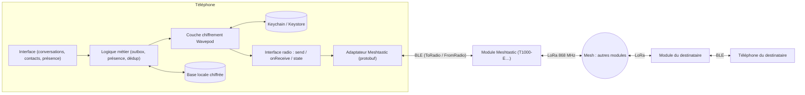
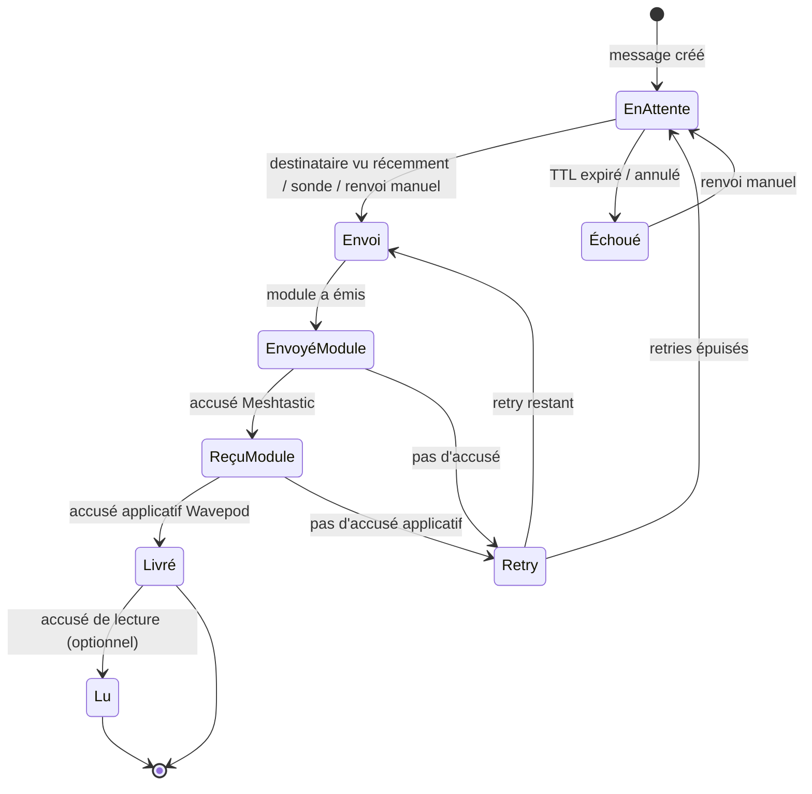

# Wavepod

Document de référence du projet. Statut : cadrage, aucune ligne de code d'application.

Conventions de lecture :
- **Décision** : choix de conception arrêté (voir `CLAUDE.md`).
- **Hypothèse** : comportement supposé d'un composant externe.
- **À valider** : chiffre ou comportement non vérifié sur matériel ou dans la documentation à jour.

## Résumé et slogan

Wavepod est une application mobile (iOS, Android) de messagerie texte privée et de réseau social local. Elle fonctionne sans internet, sans réseau cellulaire et sans satellite. Le téléphone se connecte en Bluetooth LE à un module LoRa sous firmware Meshtastic. Les messages passent par radio sur la bande 868 MHz, en direct ou relayés par le mesh.

Slogan proposé : **« Ton groupe, à portée d'ondes. »** Variante : « Tes messages, sans réseau. Tes clés, sur ton téléphone. »

## Vision et public cible

Vision : offrir une messagerie aussi simple que WhatsApp pour un groupe proche quand il n'y a pas de réseau, avec le chiffrement de bout en bout comme réglage par défaut.

Public cible :
- Groupes en zone blanche : randonneurs, alpinistes, kayakistes, chasseurs, bateaux de plaisance.
- Événements denses où le réseau sature : festivals, rassemblements, courses.
- Camps et collectivités temporaires : scouts, colonies, chantiers, zones de tournage.
- Familles et groupes d'amis qui préparent une coupure de réseau (tempête, panne).
- Plus tard, offres ciblées : équipes de bénévoles, organisateurs d'événements, petites équipes de sécurité.

Hors cible : utilisateurs qui veulent un réseau mondial, des médias ou de la voix.

## Cas d'usage

1. **Randonnée en groupe** : quatre personnes réparties sur un sentier. L'une signale « je fais demi-tour ». Les autres reçoivent le message et voient « vu il y a 4 min ».
2. **Festival** : une bande d'amis se retrouve après un concert alors que le réseau mobile est saturé. Elle fait un check-in avec sa position.
3. **Camp scout** : les responsables ont un groupe privé, chaque tente a un module, et le statut « besoin d'aide » est visible de tous.
4. **Bateau** : deux voiliers en flottille échangent des messages à quelques kilomètres sans couverture.
5. **Coupure de réseau** : une famille garde le contact dans un quartier grâce à un module fixe sur un toit qui sert de relais.

## Périmètre

### MVP
- Appairage BLE avec un module Meshtastic (868 MHz).
- Identité Wavepod : paire de clés générée et stockée sur le téléphone.
- Ajout de contact par QR code.
- Conversations privées à deux, chiffrées par Wavepod.
- File d'envoi fiable : états, accusés à deux niveaux, déduplication, TTL.
- Présence par balise optionnelle (« vu il y a X min »).
- Base locale chiffrée, affichage des messages manqués ou non livrés.

### Plus tard
- v1 : groupes, statuts, réactions, profils (bio, avatar généré), écran « autour de moi », check-in.
- v2 : confidentialité persistante, HAL multi-protocole (MeshCore, Reticulum), offres clé en main, réglages avancés pour les modules relais.
- Idée lointaine, hors périmètre : message vocal court (Codec2).

### Exclu
Photos, vidéos, appels et voix, fil public, commentaires en cascade, historique partagé pour les nouveaux arrivants, PMR446 ou seconde radio.

## Architecture

Principes :
- **Décision** : l'interface radio ne compte que trois opérations : `send(bytes, destination)`, `onReceive(bytes, metadata)`, `connectionState`. Seul l'adaptateur Meshtastic connaît le protobuf. Une HAL complète viendra plus tard.
- **Décision** : Meshtastic transporte un blob opaque sur un numéro de port privé (plage `PRIVATE_APP` à partir de 256, À valider). Il ne voit jamais le texte en clair.
- Le module ne reçoit aucune clé Wavepod.

## Chiffrement et modèle de menace

### Ce que fait Meshtastic (à vérifier dans la documentation à jour)
- Canal par défaut : clé partagée publiquement connue, donc aucune confidentialité réelle. Chiffrement des canaux en AES-CTR. AES-CCM est possible en option sur les canaux depuis la 2.8.1 (À valider).
- Messages directs depuis la 2.5 : X25519 entre modules, AES-256-CCM, tag de 8 octets, signature XEdDSA (À valider). Pas de confidentialité persistante.
- La clé privée est stockée **dans le module**. Un module perdu ou volé expose l'identité et permet d'usurper l'expéditeur.
- Les en-têtes sont en clair : expéditeur, destinataire, identifiant de paquet, sauts, relais.
- Une CVE (CVE-2025-53627) a documenté un repli silencieux vers le chiffrement de canal. C'est un argument de plus pour ne pas dépendre uniquement de la couche Meshtastic.

### Constats dans le code du firmware (v2.7.26)
- Un message direct n'est émis en PKI que si le module émetteur connaît la clé publique Meshtastic du destinataire. Sinon, le firmware refuse d'envoyer (`PKI_SEND_FAIL_PUBLIC_KEY`, « refusing to send legacy DM »). **Conséquence pour Wavepod** : avant le premier message, les deux modules doivent avoir échangé leurs NodeInfo, ou la clé Meshtastic du contact doit être injectée dans le module (piste : la mettre dans le QR Wavepod et l'ajouter par `AdminMessage`, À valider en tâche 04).
- Le destinataire rejette les messages directs non PKI (« Rejecting legacy DM »), mais seulement sur le port texte (`TEXT_MESSAGE_APP`). Les paquets Wavepod (port 256) ne sont pas concernés.
- Le PKI ajoute un surcoût (`MESHTASTIC_PKC_OVERHEAD`), et le paquet est refusé (`TOO_LARGE`) si l'en-tête, la donnée et ce surcoût dépassent 255 octets.

### Ce qu'ajoute Wavepod
- **Décision** : chaque message est chiffré et authentifié sur le téléphone avant d'être remis au module.
- Identité : paire X25519 (échange) et Ed25519 (signature, utile pour les QR et les groupes), générée sur le téléphone et stockée dans le Keychain ou le Keystore. Promesse produit : « tes clés ne quittent jamais ton téléphone ».
- Conversation à deux : clé partagée = HKDF-SHA256(X25519(moi, contact), « wavepod/v1/dm » et les deux clés publiques triées). Chiffrement AEAD ChaCha20-Poly1305. Bibliothèques : `@noble/curves`, `@noble/ciphers` et `@noble/hashes` (voir `PLAN.md`).
- Groupes (v1) : clé symétrique de groupe distribuée par messages privés chiffrés. Limite : un membre peut se faire passer pour un autre membre. Une signature par message (64 octets) est trop coûteuse et serait réservée aux messages sensibles.
- Confidentialité persistante : à étudier plus tard (rotation périodique de clés négociée hors bande ou par échange léger). Le faible débit rend un ratchet complet coûteux en accusés.

### Format de message compact (proposition)

Taille utile : la trame LoRa fait au maximum 255 octets. Le champ `payload` du message `Data` est limité à 233 octets (confirmé dans `mesh.options`, protobufs v2.8.3). Si Meshtastic chiffre aussi le message direct avec son PKI, il ajoute environ 12 octets (À valider en tâche 02).

Format implémenté dans le prototype (`app/src/protocol/codec.ts`) :

| Champ | Taille | Rôle |
|---|---|---|
| Version et type | 1 octet | 4 bits de version, 4 bits de type (texte, ack, balise, réaction…) |
| Indice de clé expéditeur | 2 octets | Premiers octets du hash de la clé publique, pour choisir la clé sans essais multiples |
| Identifiant de message | 4 octets | Aléatoire, sert à la déduplication et aux accusés |
| Extension de nonce | 8 octets | Aléatoire. Avec l'identifiant, forme le nonce de 12 octets (96 bits aléatoires) |
| Contenu chiffré | variable | Texte UTF-8, ou champs binaires |
| Tag | 16 octets | Authentification Poly1305 |

Surcoût : 31 octets. L'identifiant de message sert aussi de début de nonce, ce qui économise 4 octets. Tout l'en-tête passe en données associées. Le prototype plafonne l'enveloppe à 200 octets par prudence, soit 169 octets de texte UTF-8 (à relever après les mesures de la tâche 02). Au-delà, le message sera découpé en fragments numérotés, ou refusé dans le MVP avec un compteur de caractères.

### Modèle de menace

| Adversaire | Protégé | Non protégé |
|---|---|---|
| Écoute radio passive | Contenu, identité Wavepod | Existence d'un échange, identifiants de nœud, horaires, taille, RSSI |
| Relais malveillant | Contenu, intégrité | Graphe social (qui parle à qui), abandon de paquets |
| Module perdu ou volé | Messages et clés Wavepod | Identité Meshtastic du module, configuration du canal |
| Téléphone déverrouillé saisi | Rien côté Wavepod | Tout l'historique (option : verrou applicatif) |
| Brouillage radio | Rien | Disponibilité |

### Métadonnées qui restent visibles
- En-têtes Meshtastic : identifiant de nœud source et destination, identifiant de paquet, limite et nombre de sauts, octets de relais et de next-hop.
- NodeInfo Meshtastic : nom long et court du module, modèle matériel, clé publique du module. Recommandation : noms neutres attribués automatiquement par Wavepod.
- Positions, si le module ou la balise les diffuse. Désactivées par défaut.
- Rythme des balises, donc des habitudes de présence.
- Taille des paquets (option de padding par paliers, coûteuse en temps d'antenne).

## Contacts

- **Décision** : ajout par QR code « scanne pour m'ajouter », lien `wavepod://add#<base64url>`. Il contient les clés publiques X25519 et Ed25519, le pseudo et le `SharedContact` Meshtastic du module, le tout signé en Ed25519. Format détaillé dans `docs/qr-format.md`.
- Compatibilité Meshtastic : le `SharedContact` embarqué est le même que celui des liens `meshtastic.org/v/#...` (vérifié dans le code de Meshtastic-Android). Wavepod l'injecte dans le module avec `AdminMessage.add_contact`, ce qui lève le blocage PKI des messages directs (vérifié contre `meshtasticd`).
- **Décision** : l'adresse d'un contact est un identifiant dérivé de sa clé (par exemple les 8 premiers octets d'un hash), jamais sa position. L'identifiant de nœud Meshtastic n'est qu'un indice de routage modifiable, car le contact peut changer de module.
- Vérification : empreinte courte affichée des deux côtés (style « numéro de sécurité »).

## Réseau social local et budget d'antenne

Hypothèse de calcul : réglage LongFast (SF11, 250 kHz, CR 4/5). Un paquet de 60 octets dure environ 0,7 s à l'antenne, un paquet de 120 octets environ 1,1 s (À valider avec un calculateur LoRa).

| Fonctionnalité | Taille chiffrée | Fréquence max par personne | Remarques |
|---|---|---|---|
| Message privé | 40 à 230 octets | 20 par heure (soft limit) | Avec accusé applicatif |
| Accusé applicatif | environ 30 octets | 1 par message reçu | Groupable avec d'autres accusés |
| Message de groupe | 40 à 230 octets | 10 par heure | Diffusion, pas d'accusé individuel |
| Réaction | 1 à 2 octets utiles (environ 32 chiffrés) | 10 par heure | Référence l'identifiant du message |
| Statut court | 1 octet (code prédéfini) ou 30 octets libres | 4 par heure | Codes : randonnée, besoin d'aide, OK… |
| Profil (pseudo et bio) | jusqu'à 120 octets | À l'ajout, puis sur demande | Bio envoyée une seule fois |
| Avatar | 0 octet | Jamais émis | Généré depuis la clé, ou photo stockée localement |
| Balise de présence | environ 40 octets | 2 à 4 par heure | Optionnelle |
| Check-in avec position | environ 45 octets | 6 par heure | Position réduite (environ 10 m) |
| « Autour de moi » | 0 octet | Passif | Construit à partir des paquets entendus |

**Décision** : l'application applique ces plafonds et affiche un indicateur de « réserve d'antenne » plutôt que de laisser le module refuser silencieusement.

## Quota d'émission

**Point de contradiction signalé** : dans le brief, le réglage par défaut est à 1 %. Or la région `EU_868` de Meshtastic utilise la sous-bande 869,4 à 869,65 MHz, avec 10 % de duty cycle, 27 dBm et le preset LongFast par défaut. C'est confirmé dans le code du firmware (`src/mesh/RadioInterface.cpp`, v2.8.2).

| Réglage | Duty cycle | Messages courts par heure et par module (ordre de grandeur) |
|---|---|---|
| LongFast, sous-bande 1 % (868,0 à 868,6 MHz) | 36 s par heure | environ 50 à 55 |
| LongFast, sous-bande 10 % (869,4 à 869,65 MHz) | 360 s par heure | environ 500 |
| SF12 125 kHz, 1 % | 36 s par heure | environ 14 |
| SF7 250 kHz, 1 % | 36 s par heure | environ 600 |

Le quota réglementaire n'est pas le vrai plafond : **le canal est partagé**. Avec 20 nœuds à portée et des relais à 3 sauts, chaque message peut occuper l'antenne 3 à 4 fois. Au-delà d'environ 10 à 20 % d'occupation, les collisions montent (Meshtastic expose `channel_utilization` et `air_util_tx`, que l'application doit lire).

Consomment aussi du temps d'antenne : accusés, retries, relais, balises Wavepod, NodeInfo, télémétrie et positions Meshtastic. **Décision** : l'application désactive ou espace la télémétrie et les positions Meshtastic inutiles lors de la configuration du module.

## Présence

- **Décision** : balise optionnelle toutes les 15 à 30 minutes, affichée « vu il y a X min ». C'est un dernier signal radio, pas un statut « en ligne ».
- Tout paquet reçu d'un contact (message, accusé, NodeInfo) remet à jour son « vu ».
- Par défaut, pas de position dans la balise. Un mode discret coupe complètement la balise.
- Réutilisation de Meshtastic : les paquets NodeInfo (par défaut toutes les 3 heures, À valider) et `last_heard` dans la base de nœuds du module donnent un signal gratuit. La balise Wavepod reste utile pour la fréquence et pour lier le nœud à l'identité Wavepod de façon chiffrée.
- Balise chiffrée pour les contacts : pour ne pas révéler qui est qui, la balise contient un jeton rotatif que seuls les contacts savent associer (À étudier, coût en calcul faible).

## Livraison fiable

### Ce que Meshtastic fait déjà
- Messages directs avec `want_ack` : le module destinataire renvoie un accusé de routage. Le module émetteur retransmet quelques fois (environ 3 tentatives, À valider), puis rend un statut d'erreur (`MAX_RETRANSMIT`, `NO_RESPONSE`…).
- Diffusions : accusé implicite quand on entend un voisin relayer.
- Le module garde une petite file de paquets destinés au téléphone quand celui-ci est déconnecté (taille limitée, À valider).

### Ce qu'ajoute Wavepod
- Outbox persistante dans la base locale : identifiant unique, TTL (24 h par défaut), renvoi manuel.
- Deux niveaux d'accusé : **reçu par le module** (accusé Meshtastic) et **reçu par l'application** (accusé Wavepod chiffré). « Lu » est optionnel et désactivé par défaut.
- Déduplication côté destinataire par couple (expéditeur, identifiant de message), conservée au moins pendant le TTL.
- Règle d'envoi conditionnée à la présence, avec sonde de secours.

### Règles d'envoi
1. Si le destinataire a été vu il y a moins de la fenêtre réglable (20 à 30 min), le message est émis, avec au plus 3 retries applicatifs espacés (par exemple 30 s, 2 min, 5 min).
2. Sinon, le message reste en attente sans émettre.
3. Tout signal du contact vide sa file, dans l'ordre et avec un espacement.
4. Une sonde de secours (un seul message en attente, le plus ancien) part toutes les 1 à 2 h, pour éviter l'interblocage quand les deux côtés ont coupé leur balise.
5. Présence à sens unique (je l'entends, il ne m'entend pas) : après échec des retries, le message revient en attente, pas en échec définitif.
   - Précision d'implémentation : un signal relance seulement les messages en attente. Une série d'essais en cours garde son calendrier, et une sonde réussie vide le reste de la file (voir `tasks/05-outbox.md`).
6. Le message passe en échec à l'expiration du TTL, ou si l'utilisateur l'annule.

Affichage utilisateur : en attente, envoyé, livré, lu, échoué. Le niveau « reçu module » est visible dans le détail du message.

## Routage

- **Décision** : Wavepod ne réimplémente pas le routage.
- Diffusions : inondation contrôlée. Chaque nœud rebroadcast une seule fois, après un délai qui dépend du SNR (les nœuds lointains relaient en premier), et annule s'il entend un autre relais. La limite de sauts vaut 3 par défaut, 7 au maximum.
- Messages directs depuis la 2.6 : routage par « next hop » appris. Le premier envoi part en inondation, puis le nœud retient le relais qui a porté l'accusé. Il repasse en inondation à la dernière tentative ou si un nœud ancien se trouve sur le chemin (À valider, travaux en cours côté Meshtastic).
- Limites : saturation dans les zones denses, liens asymétriques, fuite de métadonnées par les relais (chacun voit source et destination), aucune garantie de livraison bout en bout.
- Réglages recommandés : hop limit à 3 en usage de groupe, rôle `CLIENT_MUTE` pour les modules de poche en zone dense, `ROUTER` ou `REPEATER` seulement pour les modules fixes en point haut. Canal privé (clé aléatoire) pour éviter le trafic de la communauté publique (À valider selon l'usage : un canal privé coupe aussi les relais publics).

## Stockage et arrière-plan

- **Décision** : tout est stocké dans une base locale chiffrée (SQLCipher). La clé de la base est dans le Keychain ou le Keystore.
- Les modules ne gardent que la petite file Meshtastic vers le téléphone. Pas d'historique.

### iOS
- Mode d'arrière-plan `bluetooth-central` et restauration d'état CoreBluetooth : l'application est réveillée sur notification BLE et a quelques secondes pour traiter.
- Si l'utilisateur force la fermeture de l'application, iOS ne la relance pas (À valider pour les versions actuelles).
- Notifications locales seulement, pas de push serveur (pas d'internet).

### Android
- Service au premier plan de type `connectedDevice` (Android 14 et plus), notification permanente, permissions `BLUETOOTH_SCAN` et `BLUETOOTH_CONNECT`, notifications.
- Les optimisations de batterie de certains constructeurs tuent les services. Il faut guider l'utilisateur pour l'exclusion.

### Messages manqués
- Implémenté en tâche 07 (voir `docs/arriere-plan.md`). File du module vers le téléphone : 16 paquets sur nRF52840 (firmware 2.8.2), les plus anciens perdus au-delà.
- Comparer les identifiants de paquet, les accusés manquants et le `last_heard` du contact pour signaler « messages possiblement manqués pendant la déconnexion ».
- Bandeau visible quand le module est déconnecté depuis plus de N minutes.

## Matériel compatible

| Module | Format | Radio et MCU | Antenne | Batterie | Points forts | Rôle |
|---|---|---|---|---|---|---|
| Seeed SenseCAP T1000-E | Carte, IP65 | LR1110 + nRF52840 | Interne | 700 mAh, environ 2 jours annoncés | Prêt à l'emploi, GPS, prix environ 40 USD | Référence |
| RAK WisMesh Pocket | Boîtier de poche | SX1262 + nRF52840 | SMA externe | Intégrée (À valider) | Meilleure portée, antenne remplaçable | Comparaison de portée |
| Autres modules Meshtastic 868 MHz | Variable | Variable | Variable | Variable | Doivent fonctionner via le protocole BLE | Support générique |

Point à tester : la puissance d'émission et la sensibilité réelles du T1000-E à cause de son antenne interne. Mesurer la portée réelle face à la WisMesh Pocket.

## Appairage et configuration du module

**Décision** : l'utilisateur n'installe jamais l'application Meshtastic. Wavepod gère seul l'appairage, la configuration et la synchronisation du module en BLE, avec le protocole Meshtastic public.

### Synchronisation à la connexion
1. Connexion BLE au service Meshtastic (caractéristiques `ToRadio`, `FromRadio` et `FromNum`, À valider sur la version de firmware).
2. Envoi d'un `ToRadio` avec `want_config_id`.
3. Le module renvoie dans l'ordre : `my_info`, `metadata` (version du firmware, matériel), la liste des `node_info`, la configuration, les canaux, puis `config_complete_id` (À valider).
4. Ensuite, le module transmet les paquets gardés en file pendant la déconnexion, puis les nouveaux paquets au fil de l'eau (notification sur `FromNum`).
5. Wavepod rapproche les nœuds reçus de ses contacts (identifiant de nœud, `last_heard`) pour mettre à jour la présence.

### Configuration automatique à l'appairage
Elle passe par des `AdminMessage` locaux (`set_config`, `set_channel`, `set_owner`, `set_module_config`). Une clé d'administration n'est pas nécessaire en local, elle sert à l'administration à distance (À valider).

| Réglage | Valeur appliquée par Wavepod | Raison |
|---|---|---|
| Région | `EU_868` | Un module neuf a une région non définie et n'émet pas (À valider) |
| Preset | LongFast (ou celui retenu après la tâche 2 de `PLAN.md`) | Même preset pour tout le groupe |
| Nombre de sauts | 3 | Limite la congestion |
| Rôle | `CLIENT`, ou `CLIENT_MUTE` en zone dense | Évite les relais inutiles |
| Canal principal | Inchangé (canal par défaut) | Décision provisoire : le contenu est déjà chiffré de bout en bout, et un canal privé couperait le relais par les nœuds publics (voir `tasks/08-configuration-mvp.md`) |
| Position et GPS | Désactivés | Vie privée par défaut |
| Nom du module | `WP-XXXX` | Implémenté (fin du numéro de nœud) |
| Télémétrie | Désactivée, ou intervalle long | Économie de temps d'antenne |
| Intervalle NodeInfo | Défaut Meshtastic ou plus long | Équilibre entre présence et temps d'antenne |

Avant d'écrire, Wavepod lit la configuration existante et prévient l'utilisateur si le module était déjà configuré pour un autre usage. Il garde une copie de cette configuration pour pouvoir la restaurer. Implémenté : une seule transaction d'administration, donc un seul redémarrage, puis reconnexion automatique. Un module neuf est configuré sans question, et une restauration est proposée.

### Appairage BLE et PIN
- Le T1000-E n'a pas d'écran : le firmware le met en PIN fixe (`FIXED_PIN`) au lieu d'un PIN aléatoire affiché (confirmé dans `NodeDB.cpp`, v2.8.2 ; la valeur par défaut est souvent `123456`, À valider sur le module). Décision : Wavepod ne modifie pas le PIN.
- Ce PIN ne protège que l'accès au module. Les clés Wavepod ne transitent jamais par le module, donc un PIN faible n'expose pas le contenu des messages. Il permet en revanche à un tiers proche de lire la configuration et la liste des nœuds, ou d'envoyer des paquets sous l'identité Meshtastic du module.
- Piste : remplacer le PIN fixe par un PIN aléatoire choisi par Wavepod lors de la première configuration (À valider : comportement sans écran et procédure de récupération).

### Firmware
- Le T1000-E vendu « for Meshtastic » est livré avec le firmware Meshtastic (À valider selon la référence achetée).
- Mise à jour par USB : flasheur web Meshtastic ou fichier `.uf2` glissé sur le volume du bootloader (À valider pour le T1000-E).
- Mise à jour par Bluetooth : DFU Nordic sur nRF52. Wavepod pourrait l'intégrer plus tard (bibliothèques Nordic DFU iOS et Android).
- **Décision** : Wavepod définit une version minimale de firmware et une liste de versions testées. À la connexion, il lit `metadata.firmware_version` et bloque ou avertit si la version n'est pas prise en charge.

## Limites légales (Europe, 868 MHz)

| Sous-bande | Puissance max | Duty cycle | Usage Meshtastic |
|---|---|---|---|
| 863 à 868,0 MHz | 25 mW PAR | 0,1 % (ou LBT et AFA) | Non |
| 868,0 à 868,6 MHz | 25 mW PAR | 1 % | Possible |
| 869,4 à 869,65 MHz | 500 mW PAR | 10 % | Défaut `EU_868` (confirmé, firmware v2.8.2) |

- Cadre : recommandation ERC 70-03, norme ETSI EN 300 220, transposition nationale (ARCEP en France). À vérifier pays par pays.
- Le duty cycle s'applique à l'émetteur sur une fenêtre glissante d'une heure. La réception est continue et illimitée.
- Les modules doivent porter le marquage CE pour la version 868 MHz.
- **Décision** : pas de PMR446 ni de seconde radio.

## Contraintes iOS et Android

- **iOS** : la connexion BLE est gérée par CoreBluetooth. Pas de BLE en arrière-plan illimité. Les justifications `NSBluetoothAlwaysUsageDescription` et `NSLocationWhenInUseUsageDescription` sont nécessaires pour le check-in. La revue App Store est stricte sur la description de l'usage BLE. Il y a aussi des questions de licence GPL sur l'App Store (voir Licences).
- **Android** : fragmentation BLE (MTU, comportements constructeurs), permissions Android 12 et plus, service au premier plan obligatoire, restrictions de démarrage en arrière-plan.
- **Communes** : appairage BLE avec PIN (Meshtastic propose un PIN fixe ou aléatoire, À valider pour le T1000-E), taille MTU, reconnexion automatique, stockage sécurisé des clés.

## Positionnement face à Meshtastic

| Sujet | Application Meshtastic | Wavepod |
|---|---|---|
| Messagerie, canaux, carte, QR | Oui | Oui (sans carte dans le MVP) |
| Réglages radio | Exposés (preset, région, rôle, sauts) | Cachés, préréglés par l'application |
| Clés privées | Dans le module | Uniquement sur le téléphone |
| Livraison | Accusé module et retries courts | Outbox persistante, présence, accusé applicatif, TTL |
| Vie privée par défaut | Canal public, positions souvent actives | Positions coupées, noms neutres, canal privé |
| Réseau social local | Non | Profils, statuts, réactions, autour de moi |
| Public | Technophiles, radioamateurs | Grand public, groupes non techniques |

Points pénibles chez Meshtastic pour un public non technique : vocabulaire radio, choix de région et de preset, confusion entre canaux et messages directs, absence d'état de livraison clair, nœuds inconnus dans la liste.

Plus-values de Wavepod : expérience façon WhatsApp sans réglages radio, clés uniquement sur le téléphone, livraison fiable avec file et présence, réseau social local, vie privée par défaut, offres clé en main pour des usages ciblés (module préconfiguré et application).

Risque : l'application Meshtastic s'améliore vite. La plus-value doit rester l'expérience et la confidentialité, pas une fonction isolée.

## Licences

- Firmware, applications et fichiers `.proto` Meshtastic : GPL-3.0 (le dépôt `protobufs` est indiqué GPL-3.0 ou GPL-3.0-only selon les sources, À valider sur le fichier `LICENSE`).
- Implications :
  - **Réutiliser du code des applications Meshtastic** : Wavepod devient une œuvre dérivée, donc sous GPL-3.0. Le code source doit être publié.
  - **Embarquer les `.proto` ou le code généré depuis ces fichiers** : très probablement une œuvre dérivée, donc GPL. **Avis juridique requis.**
  - **Réimplémenter le protocole sans reprendre les fichiers** (salle blanche, à partir de la documentation) : un protocole n'est généralement pas protégé par le droit d'auteur, mais c'est coûteux et risqué en pratique. **Avis juridique requis.**
- La GPL n'interdit pas la vente. Modèles compatibles : vente de modules préconfigurés, offres clé en main, support, services aux organisateurs, application payante mais open source.
- App Store : la compatibilité de la GPL-3.0 avec les conditions de l'App Store est historiquement contestée (cas VLC en 2011). Meshtastic publie son application iOS parce que les auteurs détiennent les droits. **Avis juridique requis.**
- Marque « Meshtastic » : marque déposée. Il faut respecter ses règles d'usage dans la communication (« compatible Meshtastic »). **À vérifier.**
- Licence de Wavepod : à décider. Recommandation provisoire : GPL-3.0 dès le départ, ce qui supprime le risque principal.

## Feuille de route

| Étape | Contenu | Critère de réussite |
|---|---|---|
| Prototype | 2 T1000-E et 2 téléphones, message chiffré Wavepod avec accusé | 20 messages sur 20 livrés et déchiffrés à 500 m en vue directe, accusés applicatifs reçus |
| MVP | Contacts par QR, conversations privées, outbox, présence, base chiffrée, iOS et Android | Test terrain de 4 personnes pendant 1 journée de randonnée : plus de 95 % des messages livrés dans le TTL, aucun message perdu sans indication |
| v1 | Groupes, statuts, réactions, profils, autour de moi, check-in | 10 utilisateurs non techniques installent et échangent sans aide en moins de 10 minutes |
| v2 | Confidentialité persistante, HAL (MeshCore ou Reticulum), offres clé en main | Un deuxième protocole fonctionne sans changer la logique métier. Un premier client pilote |

## Risques et questions ouvertes

- Licence GPL et distribution sur l'App Store (bloquant potentiel).
- Fiabilité du BLE en arrière-plan sur iOS, et messages perdus quand le téléphone dort.
- Stabilité de l'API BLE et du protobuf Meshtastic entre versions de firmware.
- Taille utile réelle par paquet et coût du découpage en fragments.
- Congestion du canal en zone dense (festival) : le canal partagé peut rendre l'application inutilisable.
- Duty cycle et sous-bande réellement utilisés par défaut (1 % ou 10 %).
- Autonomie réelle du T1000-E avec BLE connecté en permanence.
- Authentification de l'expéditeur dans les groupes sans signature par message.
- Compatibilité du QR Wavepod avec les liens de contact Meshtastic.
- Acceptation par le public : acheter un module à environ 40 USD est un frein.

## Identité de marque

- Nom : ondes radio et « pod », le groupe de cétacés. Le logo est une orque, dont les groupes s'appellent aussi des pods.
- **Logo** : orque blanche dans une bulle de conversation, sur fond indigo (`brand/`).
- **Couleurs** : indigo `#4F64AA` (principale), indigo foncé `#384986`, nuit `#1B2340`, ardoise `#5A6178`, brume `#EEF1F9`. Détail, usages et contrastes dans `brand/README.md`. Elles remplacent le bleu océan `#1D6FA5` et l'ancien logo dauphin.
- **Modes clair et sombre** : l'app suit le réglage du téléphone. En sombre, le fond « nuit » et l'orque blanche.
- **Icône d'application** : iOS (1024 px, sans transparence) et Android (icônes classiques et ronde, icône adaptative à fond indigo).
- **Écran de lancement iOS** : orque blanche sur fond indigo.
- Ton : simple, rassurant, factuel. Vocabulaire grand public (« à portée », « vu il y a », « livré ») plutôt que radio (« SNR », « hop »).
